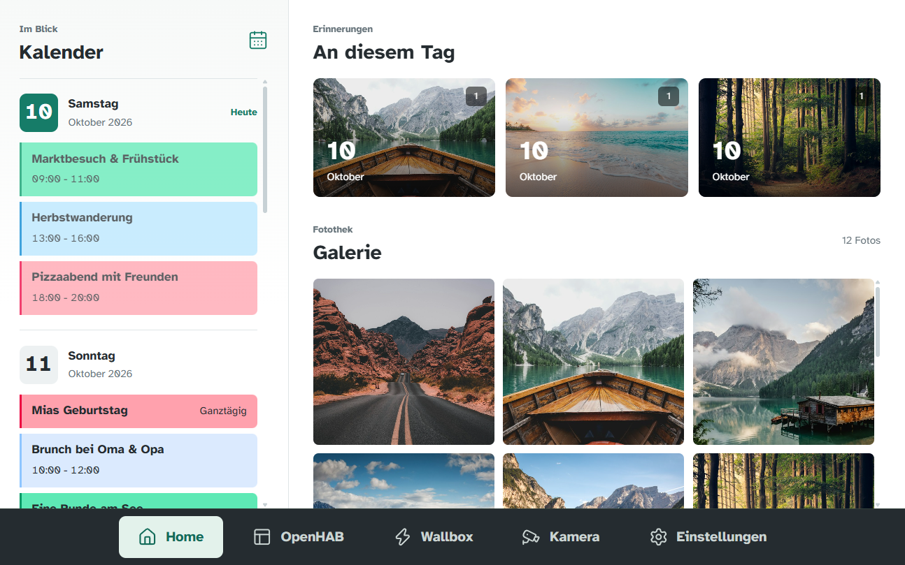
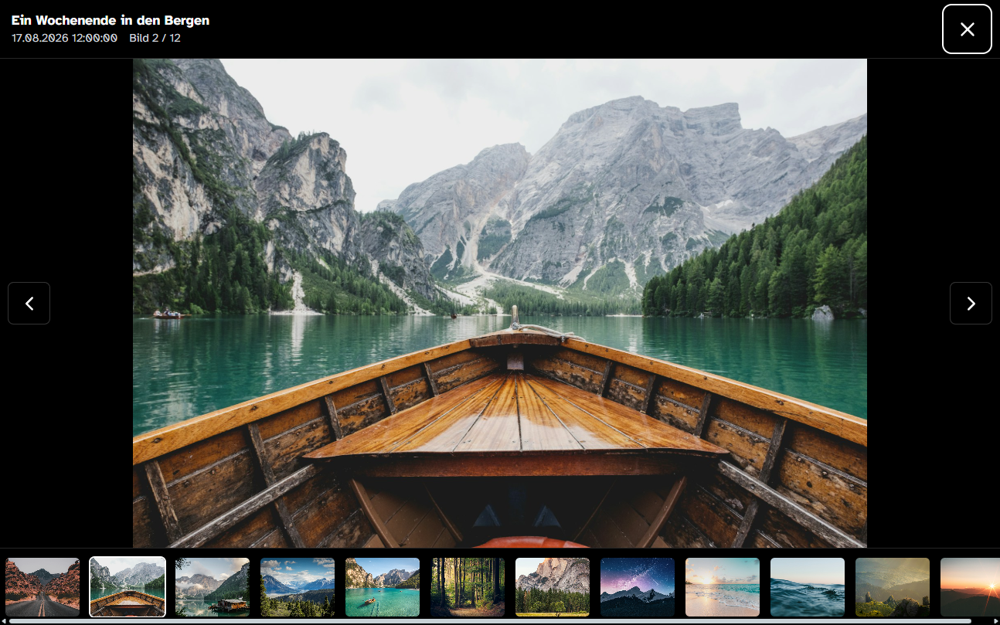

# Smart Home Dashboard

[](https://github.com/mheiss/dashboard/actions/workflows/build.yml)
[](https://github.com/mheiss/dashboard/releases)


A dashboard for your household calendars, photos, and smart-home controls.

Smart Home Dashboard brings Microsoft calendars and OneDrive photos together with openHAB, EVCC, and UniFi Protect. Designed for a wall-mounted tablet and just as useful in a browser, it gives the household a common view. A protected admin area handles account connections and source selection.



*Shared calendar on the left, a look back at this day in past years along with a gallery showing the latest photos on the right. Screenshots show the real app with fictional calendar entries and sample photography, not private household data. The current interface is in German.*

## At A Glance

| Everyday View | What It Brings Together |
| --- | --- |
| Calendar | A color-coded household agenda from selected Microsoft calendars. |
| Photos | OneDrive galleries, a look back at this day in past years, and a full-screen photo viewer. |
| Home controls | openHAB views, EVCC charging information, and UniFi Protect cameras through your existing integrations. |
| Account setup | Admin-only Microsoft account connection and calendar/photo source selection. |

The release ZIP includes the Quarkus backend and Angular interface. Microsoft synchronization and photo caching run on the server; smart-home integrations remain separate services. Deploy it on your household network behind an HTTPS reverse proxy, with Java 25 and PostgreSQL.

**[Download a release](https://github.com/mheiss/dashboard/releases)** | **[Linux setup](#linux-setup)** | **[Systemd service](#5-start-with-systemd)** | **[Development](#for-contributors)**

<details>
<summary><strong>A Closer Look: Photo Viewer</strong></summary>



Open a photo from the gallery to browse originals in the full-screen viewer. The filmstrip keeps the rest of the collection close at hand.

</details>

<details>
<summary>Demo Photography Credits</summary>

Sample photographs are from [Unsplash](https://unsplash.com/license). Original image sources used in these staged screenshots:

- [Desert road](https://images.unsplash.com/photo-1500530855697-b586d89ba3ee)
- [Boat on a mountain lake](https://images.unsplash.com/photo-1476514525535-07fb3b4ae5f1)
- [Lakeside cabin](https://images.unsplash.com/photo-1470770841072-f978cf4d019e)
- [Mountain panorama](https://images.unsplash.com/photo-1464822759023-fed622ff2c3b)
- [Turquoise lake](https://images.unsplash.com/photo-1501785888041-af3ef285b470)
- [Forest sunlight](https://images.unsplash.com/photo-1441974231531-c6227db76b6e)
- [Wildlife in the forest](https://images.unsplash.com/photo-1472396961693-142e6e269027)
- [Stars over the mountains](https://images.unsplash.com/photo-1519681393784-d120267933ba)
- [Beach at sunset](https://images.unsplash.com/photo-1507525428034-b723cf961d3e)
- [Ocean waves](https://images.unsplash.com/photo-1518837695005-2083093ee35b)
- [Mountain landscape](https://images.unsplash.com/photo-1469474968028-56623f02e42e)
- [Evening light](https://images.unsplash.com/photo-1500534623283-312aade485b7)

</details>

## Linux Setup

Run the downloaded release as a systemd service, with PostgreSQL and an HTTPS reverse proxy on the same machine. You need **Java 25**, **PostgreSQL**, **unzip**, **OpenSSL**, and an **HTTPS reverse proxy**. No Gradle, Node.js, or frontend build is needed.

Install these using your distribution's packages or the official [Java](https://adoptium.net/temurin/releases/) and [PostgreSQL](https://www.postgresql.org/download/) instructions. Follow your reverse proxy's installation guide. Check that `/usr/bin/java -version` reports Java 25; substitute its actual path in the service if needed.

This guide uses `https://dashboard.home.arpa`. Set up local DNS for that hostname and use it consistently in the proxy, Microsoft, and Keycloak settings. **Keep the dashboard on your household network:** calendar, photo, and camera viewing are public to anyone who can reach it; account setup and arbitrary upstream writes require the admin login.

### 1. Install The Release

Download the ZIP and `SHA256SUMS` from [GitHub Releases](https://github.com/mheiss/dashboard/releases). From the download directory, verify and extract them, replacing `0.0.1` with your version:

```bash
sha256sum --check SHA256SUMS
sudo install -d -m 0755 /opt/dashboard/releases/0.0.1
sudo unzip dashboard-0.0.1.zip -d /opt/dashboard/releases/0.0.1
sudo ln -s /opt/dashboard/releases/0.0.1 /opt/dashboard/latest
```

Stop if checksum verification fails. These are first-install commands; do not extract over an existing release. Keep the entire `quarkus-app/` directory together, readable by the service account but writable only by administrators.

| Location | Purpose |
| --- | --- |
| `/opt/dashboard/releases/<version>/` | Extracted application, including `quarkus-app/` and `examples/`. |
| `/opt/dashboard/latest` | Symlink to the active release directory. |
| `/etc/dashboard/` | Private `application.properties` containing all runtime settings. |
| `/var/lib/dashboard/media/` | Persistent writable photo cache and motion snapshots. PostgreSQL stores database data separately. |

### 2. Create The Database

For a new local database, open `sudo -u postgres psql` and run:

```text
CREATE ROLE dashboard LOGIN;
\password dashboard
CREATE DATABASE dashboard OWNER dashboard;
\connect dashboard
GRANT USAGE, CREATE ON SCHEMA public TO dashboard;
\q
```

Choose a database password at the prompt. If the role and database already exist, skip creating them. The schema grant is required for startup schema initialization; do not use a PostgreSQL superuser as the application's database account.

### 3. Register With Microsoft

In the [Microsoft Entra admin center](https://entra.microsoft.com/), create an app registration:

1. Choose an account type that includes **personal Microsoft accounts**.
2. Add the **Web** redirect URI `https://dashboard.home.arpa/api/accounts/callback` (not SPA).
3. Record the client ID and create a client secret; keep its **Value**, not its Secret ID.
4. Add Microsoft Graph **delegated** permissions: `User.Read`, `Calendars.Read`, and `Files.Read`. The app also requests `offline_access` for background refresh.

### 4. Configure The Dashboard

Create the service account and persistent directories. Skip `useradd` if the account already exists:

```bash
sudo useradd --system --user-group --home-dir /var/lib/dashboard --shell /usr/sbin/nologin dashboard
sudo install -d -o root -g dashboard -m 0750 /etc/dashboard
sudo install -d -o dashboard -g dashboard -m 0750 /var/lib/dashboard /var/lib/dashboard/media
```

For a **first installation only**, copy the sample and edit it. Do not overwrite existing configuration:

```bash
sudo install -o root -g dashboard -m 0640 /opt/dashboard/latest/examples/application.properties /etc/dashboard/application.properties
sudoedit /etc/dashboard/application.properties
```

In `application.properties`, replace every `REPLACE_...` placeholder with your database password, Microsoft client ID/secret, and a token-cache encryption key. Generate the key in a private terminal with `openssl rand -base64 32` for `dashboard.token-key`. Save it securely; it is required to decrypt saved Microsoft token caches.

Configure the public Keycloak client `dashboard` in your realm, for example `https://login.home.arpa/realms/dashboard`, using Standard Flow and PKCE `S256`. Register `https://dashboard.home.arpa/auth/callback` as a redirect URI, `https://dashboard.home.arpa/home` as a post-logout redirect, and the exact frontend web origin. Assign the client role `admin` to administrators and add an access-token audience mapper for `dashboard`. See [Keycloak Authentication](server/README.md#keycloak-authentication) for details.

The frontend loads its Keycloak server, realm, and client ID from the backend's public `/api/config` response. These values are derived from `quarkus.oidc.auth-server-url` and `quarkus.oidc.client-id` in backend configuration. Set the realm URL in the properties file, restart the backend, and reload the browser; no frontend rebuild is needed.

Change the sample's paths and hostname as needed:

```properties
dashboard.media-directory=/var/lib/dashboard/media
dashboard.microsoft.redirect-uri=https://dashboard.home.arpa/api/accounts/callback
quarkus.oidc.auth-server-url=https://login.home.arpa/realms/dashboard
```

Keep `quarkus.http.host=127.0.0.1` for this same-machine deployment. Configure Quarkus to accept forwarding headers only from your reverse proxy so it can determine the public host and HTTPS scheme correctly. Leave `dashboard.microsoft.webhook-url` unset; scheduled synchronization needs no public webhook.

Provision media storage separately from configuration and application binaries. The default cache budgets are 10 GiB for originals and 1 GiB for thumbnails, plus motion snapshots and temporary downloads. Cache cleanup runs hourly, so allow extra free space; these budgets are not hard disk-capacity limits. See the backend configuration reference to adjust them.

All dashboard APIs use `/api`; UI navigation stays at the HTTP root. Register the Microsoft Web redirect URI at `/api/accounts/callback`. If using public webhooks, configure the webhook URL and its public proxy rule for `/api/graph/webhook`.

`application.properties` holds backend credentials, authentication settings, and smart-home configuration. The backend exposes only `sitemapUrl`, `evccUrl`, `cameras`, and public `keycloak` connection settings through `/api/config`; it never serves the properties file or its secrets. Microsoft source selections are stored in the database. Keep the active properties file private and out of Git. Advanced runtime settings and environment overrides are covered in the backend reference: [server/README.md](server/README.md) on GitHub, or `BACKEND.md` in the release ZIP.

### 5. Start With Systemd

Create `/etc/systemd/system/dashboard.service`:

```ini
[Unit]
Description=Smart Home Dashboard
Wants=network-online.target
After=network-online.target

[Service]
Type=simple
User=dashboard
Group=dashboard
StateDirectory=dashboard
StateDirectoryMode=0750
WorkingDirectory=/var/lib/dashboard
ExecStart=/usr/bin/java -Dquarkus.config.locations=/etc/dashboard/application.properties -jar /opt/dashboard/latest/quarkus-app/quarkus-run.jar
Restart=on-failure
RestartSec=5
TimeoutStopSec=30
UMask=0027
NoNewPrivileges=true
PrivateTmp=true
ProtectSystem=strict
ProtectHome=true

[Install]
WantedBy=multi-user.target
```

The service explicitly reads `/etc/dashboard/application.properties`. `/var/lib/dashboard` is its working directory and writable state directory; binaries and configuration remain read-only. Logs go to journald. PostgreSQL must be running; network readiness alone does not guarantee database readiness.

```bash
sudo systemd-analyze verify /etc/systemd/system/dashboard.service
sudo systemctl daemon-reload
sudo systemctl enable --now dashboard
sudo journalctl -u dashboard -f
```

First startup initializes the database schema; administrators are managed in Keycloak. Check readiness with `curl --fail http://127.0.0.1:8080/q/health/ready`.

### 6. Set Up HTTPS And Connect Accounts

Configure your HTTPS reverse proxy for `dashboard.home.arpa` with a certificate trusted by your viewing devices. Forward all requests unchanged to `http://127.0.0.1:8080`, including WebSocket upgrades, and use suitable WebSocket idle timeouts. Validate and reload the proxy configuration using its own tooling.

If using a private certificate authority, install its public root CA certificate in every client device's trust store; never distribute the CA's private key. Allow HTTPS on the LAN, keep port 8080 on loopback, and do not forward the dashboard to the internet.

Open `https://dashboard.home.arpa/home` without certificate warnings. Click settings, sign in through Keycloak, and connect each owner's Microsoft account. Select calendars and enable OneDrive folders such as `Pictures/Camera Roll` in `/setup`. Synchronization normally runs every five minutes. Use `/home` as the wall tablet's start URL.

<details>
<summary>Optional Smart-Home Integrations</summary>

openHAB, EVCC, and go2rtc run separately. Configure their URLs, item mappings, and camera IDs in `/etc/dashboard/application.properties`. Embedded views must be reachable from the tablet over HTTPS and allow iframe embedding.

On desktop and mobile, navigation hides OpenHAB when `dashboard.openhab.sitemap` is empty or whitespace-only, Wallbox when `dashboard.evcc.url` is empty or whitespace-only, and Kamera when no cameras are configured. These rules hide navigation links only; they do not disable routes or change access permissions. Restart the backend and reload the browser after changing properties.

The backend hosts the openHAB HTTP/WebSocket and go2rtc snapshot/signaling proxy routes. Keep the HTTPS proxy forwarding requests unchanged; do not add path rewrites or openHAB credentials to it. Configure integration settings in the **private** properties file:

```properties
dashboard.proxy.openhab-url=http://openhab.home.arpa:8080
dashboard.proxy.openhab-token=REPLACE_OPENHAB_API_TOKEN
dashboard.proxy.go2rtc-url=http://127.0.0.1:1984
dashboard.openhab.sitemap=https://openhab.home.arpa/basicui/app
dashboard.openhab.items.security=Security
dashboard.openhab.items.doorbell=Entrance_Bell_Switch
dashboard.openhab.doorbell-camera=entry
dashboard.evcc.url=https://evcc.home.arpa
dashboard.protect.cameras[0].id=entry
dashboard.protect.cameras[0].label=Eingang
```

Use HTTP(S) origins without API paths or embedded credentials, reachable from the backend. Restart the dashboard after changing properties. Environment alternatives are `DASHBOARD_OPENHAB_URL`, `DASHBOARD_OPENHAB_TOKEN`, and `DASHBOARD_GO2RTC_URL`. Unconfigured integrations return HTTP 503; the rest of the dashboard remains available.

The backend owns openHAB item states and doorbell/motion decisions through one upstream connection. Clients receive camera-selection and security-state actions through `/api/graphql`, without parsing openHAB items. Motion snapshots are captured even without connected browsers and stored with metadata under `/var/lib/dashboard/media/protect/`; the newest 20 detection groups are shared through GraphQL and `/api/media/protect/{id}`. Camera indices determine display order; each camera requires a unique ID and a label. Restart the backend after changing settings, then reload the browser.

Camera signaling uses `/api/ws/webrtc`; live preview frames use `/api/webrtc/*`. The backend injects openHAB authentication and removes go2rtc's upstream `Origin` header. Camera viewing and stored history are public; arbitrary upstream HTTP writes and the openHAB WebSocket bridge require the `dashboard` client's `admin` role. Keep the deployment on the trusted household network and protect the private token.

Configure [go2rtc](https://github.com/AlexxIT/go2rtc/) with streams named `unifi_<cameraId>` and `unifi_<cameraId>_medium`, matching `dashboard.protect.cameras[n].id`. WebRTC media still connects using go2rtc's advertised network candidates; the backend proxies signaling, not media. Embedded openHAB and EVCC pages still require direct browser access.

Verify initial openHAB states, live item updates, commands, camera snapshots, and live video through the dashboard origin. The backend reference's **Smart-Home Proxy** section covers timeouts, troubleshooting, and tests: [server/README.md](server/README.md#smart-home-proxy) on GitHub, or `BACKEND.md` in the release ZIP.

</details>

## Service Operations

```bash
sudo systemctl status dashboard
sudo journalctl -u dashboard -n 100 --no-pager
sudo systemctl restart dashboard
```

Restart after changing any application properties, then reload the browser to obtain updated public settings. After changing the unit, run `sudo systemctl daemon-reload` before restarting.

Renew expiring Microsoft client secrets in the properties file and restart. Manage administrator credentials and the `dashboard` client role `admin` in Keycloak.

### Optional File Logging

To also write `/var/log/dashboard/app.log`, add these properties to `/etc/dashboard/application.properties`:

```properties
quarkus.log.file.enabled=true
quarkus.log.file.path=/var/log/dashboard/app.log
quarkus.log.file.rotation.max-file-size=10M
quarkus.log.file.rotation.max-backup-index=5
```

Run `sudo systemctl edit dashboard` and add a service override:

```ini
[Service]
LogsDirectory=dashboard
LogsDirectoryMode=0750
```

Systemd creates the log directory with the service user's ownership and makes it writable despite `ProtectSystem=strict`. Run `sudo systemctl daemon-reload` and `sudo systemctl restart dashboard`. Console logging continues to journald; set `quarkus.log.console.enabled=false` only if file-only application logging is desired.

## Troubleshooting

Start with `sudo journalctl -u dashboard -n 100 --no-pager`.

| Symptom | Check |
| --- | --- |
| Service fails to start | Java 25 path, `latest` symlink, file permissions, and unreplaced properties placeholders. |
| Database errors | PostgreSQL availability, credentials, and `USAGE, CREATE` privileges on the database's `public` schema. |
| HTTPS or proxy errors | Local DNS, trusted CA, reverse proxy logs, and backend readiness on `127.0.0.1:8080`. |
| `/api/config` returns 503 | Keycloak issuer ends in `/realms/<realm>` and camera IDs are unique. Inspect backend logs for configuration errors. |
| Microsoft sign-in or requests fail | Redirect URI matches your public HTTPS URL; the proxy preserves the public host and scheme through trusted forwarding headers. Retain the original token key. |
| API returns 401 after Keycloak login | Access token includes audience `dashboard`; frontend and backend use the same realm. Configure an access-token audience mapper and sign in again. |
| Calendar or gallery is empty | Connect accounts, select and enable sources, then allow time for synchronization. |
| Image downloads report no space left | Check free bytes and inodes on the configured media directory's filesystem and available backing storage on the host. Allow space beyond the cache budgets for concurrent downloads. |

## For Contributors

The source repository contains `server/` (Quarkus) and `ui/` (Angular). Developer setup, formatting, tests, and builds are documented in [server/README.md](server/README.md) and [ui/README.md](ui/README.md). These source-directory links apply on GitHub, not in the extracted ZIP, which includes the backend reference as `BACKEND.md`.

Every push and pull request runs **Build** and produces a downloadable deployment artifact. Publishing a GitHub Release builds its tag and attaches the application ZIP and `SHA256SUMS`. You do not need these pipelines to use a downloaded release.
